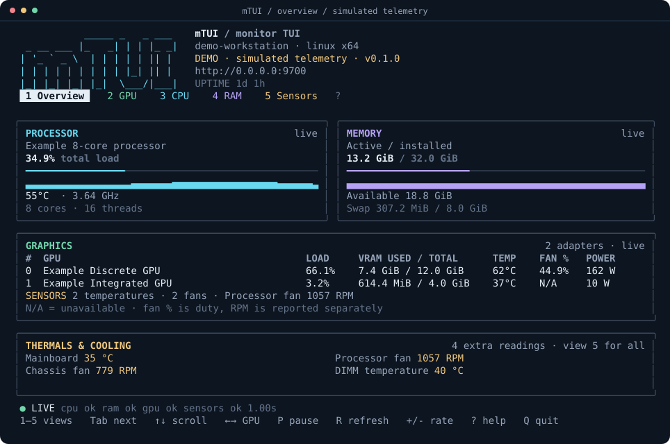

# mTUI

**Your hardware, clearly.**

```text
           _____ _   _ ___
 _ __ ___ |_   _| | | |_ _|
| '_ ` _ \  | | | | | || |
| | | | | | | | | |_| || |
|_| |_| |_| |_|  \___/|___|
```

mTUI (monitor TUI) is a Bun application for monitoring graphics adapters, processor cores, memory and hardware sensors. A compact overview leads into dedicated detail screens. The same telemetry is available through a standalone JSON API and a remote terminal client.



## One-command installation

The installer handles a fresh machine or updates an existing checkout. It installs or upgrades Bun when needed, installs dependencies, repairs incomplete installations (including a fallback to npm when available), validates the build, prepares local sensors, deploys the standalone executable to your home directory and launches mTUI. Git is optional: without it, the installer downloads a source archive.

**Windows (PowerShell):**

```powershell
irm https://raw.githubusercontent.com/kitty-crow/mtui/main/install.ps1 | iex
```

**Linux and macOS (Bash):**

```sh
curl -fsSL https://raw.githubusercontent.com/kitty-crow/mtui/main/install.sh | bash
```

Windows installs to `$HOME\mTUI\mtui.exe`; Linux and macOS install to `~/mTUI/mtui`. Run these same commands again to update and redeploy. If Windows sensor drivers require administrator access or a restart, setup reports this; no automatic driver installation can bypass an OS permission prompt.

To install without launching, invoke a checked-out installer as `./install.sh --no-launch` or `.\install.ps1 -NoLaunch`. The standalone executable needs neither Bun nor npm once built.

## Start monitoring from source

Requires **Bun 1.4.4 or later** on Linux, Windows or macOS when choosing to build manually. The terminal interface fits **70 × 24** cells; **110 × 32** gives charts and sensor summaries more room.

```sh
git clone https://github.com/kitty-crow/mtui.git
cd mtui
bun install --frozen-lockfile
```

Copy `.env.example` to `.env` and choose the API port:

```dotenv
MTUI_PORT=9700
```

Start the terminal and its LAN API:

```sh
bun run start
```

Use `bun run demo` to explore the interface with simulated hardware. Demo mode is labelled in the terminal and JSON responses.

`bun run build` also runs sensor setup for the current host. If you run from source without building, use `bun run start --setup-sensors` first. Downloaded executables provide the same `--setup-sensors` option. Setup selects the appropriate host adapter automatically; see the [platform guide](docs/platforms.md) for driver and permission details.

## Views

| View | Contents |
| --- | --- |
| Overview | Processor and memory usage, GPU comparison table, reported thermals and cooling |
| Graphics | All adapters, selected GPU details, VRAM, clocks, power, fan duty and history |
| Processor | Package load and temperature, per-thread utilisation, user/kernel load and clocks |
| Memory | Active, available and cached memory, swap allocation and installed modules |
| Sensors | Reported temperatures, fan speeds, power and voltages, with source and freshness |

Press **1–5** to change views, **Tab** to cycle, **↑/↓** to scroll and **←/→** to select a GPU. **P** pauses monitoring, **R** refreshes, **+/-** adjusts the sampling delay, **?** opens help and **Q** exits. mTUI restores the previous terminal screen on exit.

Readings use **N/A** when a driver does not expose a measurement. A stopped fan can report **0%** or **0 RPM**; these are valid values. Failed collectors retain their last successful values with a **stale** status and original timestamp.

## LAN API and remote terminals

The API listens on **0.0.0.0** using `MTUI_PORT` from `.env`. Run it independently of the terminal:

```sh
bun run serve
```

Connect a terminal on another computer:

```sh
bun run start --connect http://192.168.1.50:9700
```

The remote client displays the host's hardware and handles connection loss with stale readings. It does not inspect the client's hardware or start another API listener.

| Endpoint | Reading |
| --- | --- |
| `/gpu` | All installed graphics adapters |
| `/gpu/1` | The second adapter |
| `/gpu/0/temp` | GPU temperature |
| `/gpu/0/vram/used` | Allocated graphics memory in bytes |
| `/proc/cores/0/usage` | First logical processor utilisation |
| `/ram` | Memory, swap and module inventory |
| `/sensors` | All sensor channels shown in the interface |
| `/snapshot` | Complete, versioned telemetry snapshot |
| `/history` | Timestamped chart data |

Append property names and array indices to inspect resource objects at any depth. For example, `/ram/modules/0/size` returns the first installed module's capacity. Read the [API reference](docs/api.md) for envelopes, units, authentication and error codes.

Set `MTUI_TOKEN` in the host's `.env` to enable bearer authentication. Set the same variable on a remote TUI client. API requests then use `Authorization: Bearer <token>`.

## Command line

```sh
bun run start --no-api                  # Local terminal only
bun run start --once                    # Print one overview
bun run start --json                    # Print one complete JSON snapshot
bun run start --interval 2000           # Delay between completed samples
bun run start --history 300             # Retain 300 samples per chart
bun run start --no-colour --no-motion   # Plain colours and a static activity marker
bun run start --ascii                   # ASCII borders, meters and charts
```

When stdin or stdout is redirected, mTUI prints one overview and exits. `--serve` runs continuously without a TTY. `--once` and `--json` do not start a listener. `--help` lists all options.

## Hardware support

CPU load, per-thread usage and memory statistics use the operating system's counters. Graphics and temperature coverage varies with drivers, firmware and permissions. NVIDIA driver telemetry is discovered through `nvidia-smi` when available; Linux DRM counters supplement graphics readings. Linux hwmon and optional Windows LibreHardwareMonitor/OpenHardwareMonitor WMI providers supply extra sensors.

Available CPU sensor channels feed the processor overview and JSON metrics as well as the Sensors screen. NVIDIA memory temperatures are queried independently of load and fan counters, so an unsupported thermal channel does not interrupt other GPU readings. Missing measurements are `null` in JSON and appear as `N/A` with an unavailable status in the sensor table.

Platform adapters discover available readings automatically. Windows uses an existing compatible WMI provider when present, or starts an integrated, headless LibreHardwareMonitor library reader. The library is downloaded from its official release on first use, verified against a pinned SHA-256 digest, and cached under `%LOCALAPPDATA%\mTUI\sensors`. No GUI application needs to run.

Sensor setup uses the host's platform adapter. Linux and macOS check their available native sensor providers. The Windows adapter prepares the pinned LibreHardwareMonitor library and installs PawnIO 2.2.0 when no PawnIO installation exists; existing driver installations are retained. That adapter requires an administrator terminal and reports when a restart is needed. Remote clients do not need hardware-access privileges. Normal monitoring never installs drivers or requests elevation.

Hardware and firmware determine which sensors exist. Unsupported measurements remain unavailable.

The [platform guide](docs/platforms.md) describes available readings and common gaps. Temperature colours are visual guides at 75°C and 90°C, rather than device-specific thermal limits.

## Build and development

```sh
bun run validate
bun run build
```

The build validates the source and tests, runs sensor setup for the current host, then compiles and verifies `dist/mtui` or `dist/mtui.exe`, including the Bun runtime. Sensor setup is part of the build on Linux, Windows and macOS. The selected adapter handles platform-specific prerequisites and permissions.

To produce an executable without installing sensor support, such as on a CI runner:

```sh
bun run build --skip-sensor-setup
```

If you skipped setup, downloaded an executable, or run directly from source, the optional standalone step is:

```sh
bun run start --setup-sensors
```

With a compiled executable, use `./mtui --setup-sensors` or `.\mtui.exe --setup-sensors`. A successful local build already performs this step. Setup reports any privileges or restart required by the host adapter.

The **Validate and build** GitHub Actions workflow is started manually and builds on Linux, Windows and macOS. It skips local driver installation when producing its executable artifacts.

The source is organised around typed domain models, replaceable collectors, a monitoring engine, HTTP resources and terminal views. Start with the [architecture guide](docs/architecture.md) to add a collector or screen.
